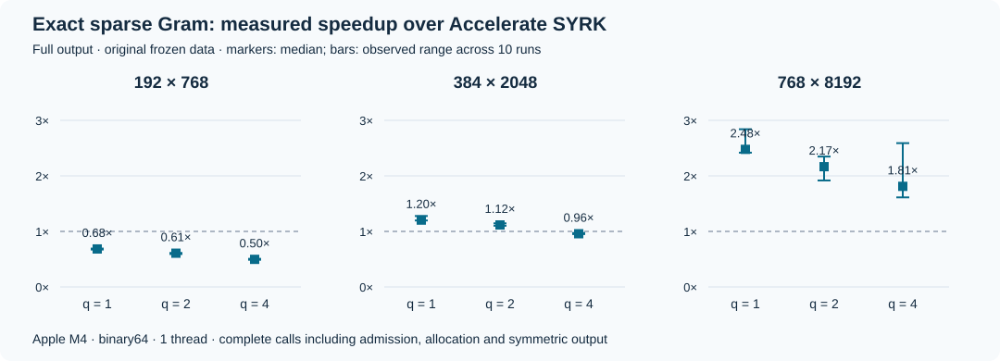

# Exact Gram matrices from sparse row shifts

**A proved sequential factor-replacement schedule with validated exact binary64
output—and a measured structured regime in which it beats vendor BLAS.**

Leonard van Hemert · Version 1.0.0 · 19 October 2026

[](https://github.com/LeonardSEO/exact-sparse-gram/actions/workflows/verify.yml)

[Paper](paper.pdf) · [Paper source](paper.tex) · [Proof and trust boundaries](docs/LEAN_VERIFICATION.md) · [Reproducibility](docs/PROVENANCE.md) · [Claim–evidence map](CLAIM_EVIDENCE.md)



This artifact computes `G = A Aᵀ` when successive dense rows differ from a
one-coordinate shift at a small set of positions. The schedule first replaces
the left factors, then the right factors. Every prefix remains a sum of at most
`n` products of bounded actual input factors. Overlapping supports need neither
a merge nor a special branch.

For `A = 2^e X`, integer `|X[i,k]| ≤ B` and `n B² ≤ 2^53`, this invariant proves
exact intermediate arithmetic and exact real Gram entries in binary64, under
the stated IEEE arithmetic assumptions. The implementation checks the actual
dense input on every call; it performs no quantization. Its supported domain is
`n ≤ 65536`, `-400 ≤ e ≤ 200`, and at most 64 shifted defects per row. The public
API returns the lower triangle and a success/rejection status.

The proved Gram FMA count is `mn + 2(P-m) + mQ`, where `P=m(m+1)/2` and `Q` is the
total defect count. The concrete contribution is the execution schedule, complete
prefix guarantee, admission check and implementation. It builds on established
displacement-product algebra and exact bounded-integer floating arithmetic.

## What we prove

- **Correctness for the entire stated input class:** exact anchors and the sparse row-shift recurrence reconstruct every Gram entry, for arbitrary mathematical dimensions.
- **Safety of every arithmetic prefix:** both replacement phases preserve a sum of bounded actual input products. This gives the intermediate bound that makes the sequential order exact; the paper supplies a concrete failure of grouped order.
- **Exact binary64 arithmetic:** the bounded dyadic class satisfies the representability bounds at every step, under the explicit primitive arithmetic assumptions.
- **The arithmetic work count:** `mn + 2(P-m) + mQ` Gram FMAs for nonempty dimensions, with linear sparse temporary storage in the delivered implementation.

These claims have complete written proofs and **53 inspected Lean declarations**.
Two independent Lean builds pass, and their theorem types and axiom reports agree
byte for byte. The trusted machine-arithmetic bridge is stated explicitly;
implementation behavior is separately checked against exact integer oracles.

## Measured evidence

For one full-output accumulated-innovation case (`768×8192`, q cap 2, e −15,
uniform signed 16-bit coefficients, seed 20261201), the frozen sequential member
has median time **9.0460 ms**, versus SYRK **19.6336 ms**. The median paired
SYRK speedup is **2.169×**, with conditional within-run 95% block interval
**[2.164, 2.175]**; the paired native-GEMM speedup is **2.277× [2.272, 2.282]**.

All **230 frozen comparisons**, six complete method series, losing cases, source
hashes and environment metadata are retained. The candidate beats both vendors
in 150 runs. Every tested `192×768` case loses: all 60 such comparisons. All tested
`768×8192` cases and all 50 full-output `512×4096` distribution cases win against
both vendors. [Inspect every run and group](analysis/generated/lattice_selected_measurements.md),
[all per-run statistics](analysis/generated/lattice_summary.csv), or
[the raw observations](data/round2/lattice_final_all.jsonl).

These measurements use Apple M4 / Accelerate FP64, one thread, warm repeated
operands and complete calls including validation, allocation and output
materialization. Five blocks of six paired samples underpin the intervals;
these describe within-run variability. Lower/full and scaled inputs are reused,
and some deterministic patterns repeat across seeds. The result is scoped to the
recorded regime. [Full protocol and provenance](docs/PROVENANCE.md).

A **separate 20-run specialized comparison** tests a reconstructed Hankel plus
sparse correction implementation under the same dense-input and full-output
contract. The sequential method wins all 20 runs against this comparator and
both dense vendors. Its run-level speedups over the focused comparator range
from **1.71–1.78×** on corrected windows to **42.01–46.30×** on accumulated
innovations, where reconstructed corrections grow much larger than local
defects. This is a concrete structured comparison; it does not establish a
ranking against every structured algorithm. [Protocol, source and results](docs/SPECIALIZED_COMPARATOR.md).

```sh
python3 analysis/make_paper_assets.py
python3 benchmarks/specialized/summarize.py \
  data/specialized_2026-10-19/specialized_raw.jsonl \
  --manifest data/specialized_2026-10-19/frozen.json \
  --output /tmp/gram-specialized-summary.csv
```

## Build and check

The portable core needs a C11 compiler, IEEE binary64 and correctly rounded FMA.
The Python tests and analysis use only the standard library. On Linux, consumers
link the static library with `-lm`.

```sh
./scripts/build.sh
./scripts/test.sh
python3 analysis/reproduce.py
```

The library is `build/libgram_exact.a`; include [gram_exact.h](include/gram_exact.h).
The frozen implementation's SHA-256 is
`7550990a7f6dd82fbd0e58580c9a6639eef7ffc07d841b56ae9cf189b394bde5`.
The API preserves upper-triangle/padding values and requires disjoint valid input
and output objects. Discard partial output on rejection. See the header for
parameter limits and status codes.

Portable native/scalar tests compare 2,044 lower entries per implementation
against direct Python integer dots with exact Fraction scaling, alongside
boundary/rejection checks, an actual-FMA ordering counterexample and finite
symbolic/prefix checks. They supplement the proof.

On macOS, an additional independent integer-first full-entry oracle checks four
representative large matrices, each with contiguous and padded layouts:

```sh
./scripts/test_full_oracle.sh
```

The successful recorded validation checks **5,050,624 output entries**: 1,263,744
sequential, 1,263,744 SYRK and 2,523,136 native-GEMM entries. All are exactly equal;
there are no missing/nonfinite outputs, input changes or padding violations.
These counts cover these representative cases, rather than all 230 timed inputs.
Historical receipts remain under `evidence/original/`; fresh local receipts go
under `evidence/validation/`.

## Check the Lean proof

The project pins Lean **4.24.0** and mathlib commit
`f897ebcf72cd16f89ab4577d0c826cd14afaafc7`, with transitive revisions recorded in
the manifest. With [elan](https://github.com/leanprover/elan) installed:

```sh
cd lean
lake exe cache get
lake build
lake env lean evidence/Inspect.lean
```

Lean checks the algebraic recurrence, both prefix invariants and bounds, work
count, and rounded reconstruction under an explicit primitive rounding model.
The binary64 bridge states its machine-arithmetic assumptions explicitly. The
formalization does not verify the C parser, memory accesses, compiler or
hardware. Read the [verification report](docs/LEAN_VERIFICATION.md) and
[independent audit](docs/LEAN_INDEPENDENT_AUDIT.md) for the exact theorem scope,
axioms and external trust boundary.

## Reproduce the benchmark

The original six-method drivers and their local dependencies are retained under
`benchmarks/round2/`. Build and inspect the fresh plan on macOS:

```sh
./scripts/build.sh --benchmarks
python3 benchmarks/round2/run.py --dry-run
```

To repeat the full campaign, run the following **without competing compute**:

```sh
python3 benchmarks/round2/run.py --grid all
python3 analysis/reproduce.py --data-dir data/reproduced --output-dir analysis/reproduced
```

Fresh files cannot overwrite the supplied frozen measurements. Method13 stays
preselected throughout. The merged-support method12 is already a specialized
same-contract comparator; [the comparator assessment](docs/SPECIALIZED_COMPARATOR.md)
describes its scope and further comparison boundaries. Packaging and correctness
validation do not constitute new performance measurements.

## Paper, citation and licensing

Compile the manuscript with a standard LaTeX installation:

```sh
pdflatex -interaction=nonstopmode -halt-on-error paper.tex
bibtex paper
pdflatex -interaction=nonstopmode -halt-on-error paper.tex
pdflatex -interaction=nonstopmode -halt-on-error paper.tex
```

Use [CITATION.cff](CITATION.cff) to cite version 1.0.0. Source code, scripts and Lean
proofs are [MIT licensed](LICENSE). The paper, documentation and data are licensed
under [Creative Commons Attribution 4.0](LICENSES/CC-BY-4.0.txt). External dependencies
retain their own licenses and are fetched separately. See [license scope](LICENSES/README.md).
